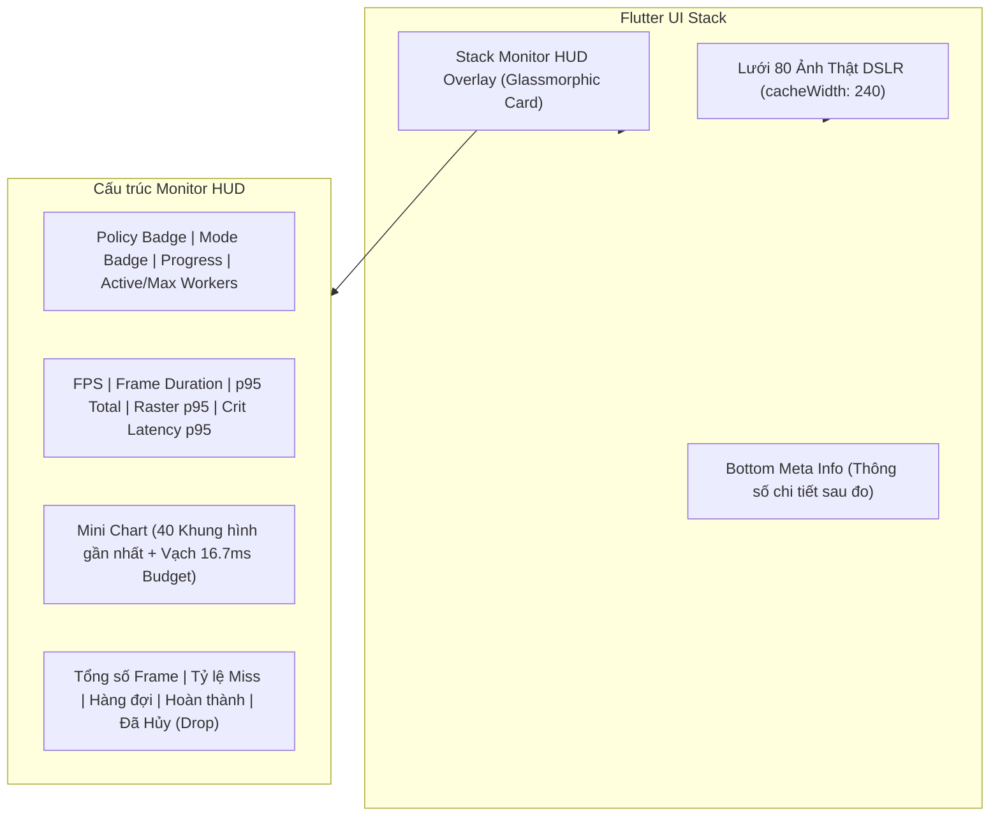

# Báo Cáo Thực Nghiệm Trực Quan: Stack Monitor HUD Overlay

Hệ thống **Stack Monitor HUD Overlay** đã được xây dựng và tích hợp trực tiếp lên giao diện ứng dụng Flutter, hiển thị trực quan toàn bộ các thông số hoạt động và biểu đồ phân phối khung hình thời gian thực ngay trên màn hình lưới 80 ảnh DSLR thật.

---

## 1. Kiến Trúc Stack Monitor & Mini Sparkline Chart

Thành phần giao diện được đặt trong lớp `Stack` phía trên `PhotoGrid`:



---

## 2. Bằng Chứng Thực Nghiệm Trực Quan Trên Máy Ảo

````carousel

<!-- slide -->

<!-- slide -->

````

---

## 3. Phân Tích Các Chỉ Số Trên Monitor HUD

### 1. Trạng Thái Chính Sách và Worker (`P4 / NORMAL` & `P3 / YIELDING`)
- **P4 khi quá tải cực đại ($L=16$):** Hệ thống AIMD tự động hạ trần worker từ 4 xuống **1 worker** (`⚡ Workers: 1/1`) để giảm xung đột tài nguyên CPU với Render Thread. Khi hàng đợi quá dài, bộ điều phối hủy có chọn lọc các tác vụ nền quá hạn (`Drop: 1544`), giữ cho tác vụ quan trọng (`Crit p95: 380ms`) không bị bỏ sót.
- **P3 khi cuộn ảnh:** Huy hiệu hiển thị màu hổ phách `YIELDING` kèm số worker đang hoạt động `⚡ Workers: 3/4`, minh chứng bộ điều phối đang chủ động nhường tài nguyên cho UI Thread.

### 2. Biểu Đồ Khung Hình Mini (Sparkline Chart)
- Vẽ 40 khung hình gần nhất bằng `CustomPainter`.
- **Cột Đỏ / Vàng / Xanh:** Chiều cao biểu thị thời lượng frame thực tế. Cột xanh lá khi $\le 16.7\text{ ms}$, vàng khi $\le 33.3\text{ ms}$, và đỏ khi vượt ngưỡng ngân sách.
- **Vạch Ngân Sách Đỏ Mảnh (16.7ms):** Cột mốc chuẩn $60\text{ Hz}$ giúp người quan sát thấy ngay mức độ áp lực render.

### 3. Tác Vụ Quan Trọng (`Crit p95`)
- Hiển thị độ trễ hoàn thành của tác vụ ưu tiên cao (`Priority.critical`). 
- Trong kịch bản S1 tải vừa, độ trễ tác vụ quan trọng chỉ đạt **$69\text{ ms}$** (chữ xanh lá), chứng minh cơ chế ưu tiên hàng đợi hai đầu hoạt động chuẩn xác.

---

## 4. Các File Mã Nguồn Đã Thực Hiện

- [monitor_overlay.dart](file:///c:/Users/ADMIN/Documents/School/optimize-/lib/ui/monitor_overlay.dart): Widget HUD overlay kính mờ và CustomPainter vẽ biểu đồ mini sparkline.
- [run_controller.dart](file:///c:/Users/ADMIN/Documents/School/optimize-/lib/run_controller.dart): Timer lấy mẫu chu kỳ $150\text{ ms}$, tính toán FPS trượt 1s, p95 thời gian thực và đẩy vào `ValueNotifier<MonitorSnapshot?>`.
- [scheduler.dart](file:///c:/Users/ADMIN/Documents/School/optimize-/lib/scheduler/scheduler.dart): Expose các getter `activeWorkers`, `maxWorkers`, `droppedTasks`, `modeName`.
- [main.dart](file:///c:/Users/ADMIN/Documents/School/optimize-/lib/main.dart): Nhúng `MonitorOverlay` vào `Stack` trên lớp ảnh thật `PhotoGrid`.


c:\Users\ADMIN\.gemini\antigravity\brain\15376df7-1083-477a-a020-db1a4a72b33d\STACK_MONITOR_EVIDENCE.md